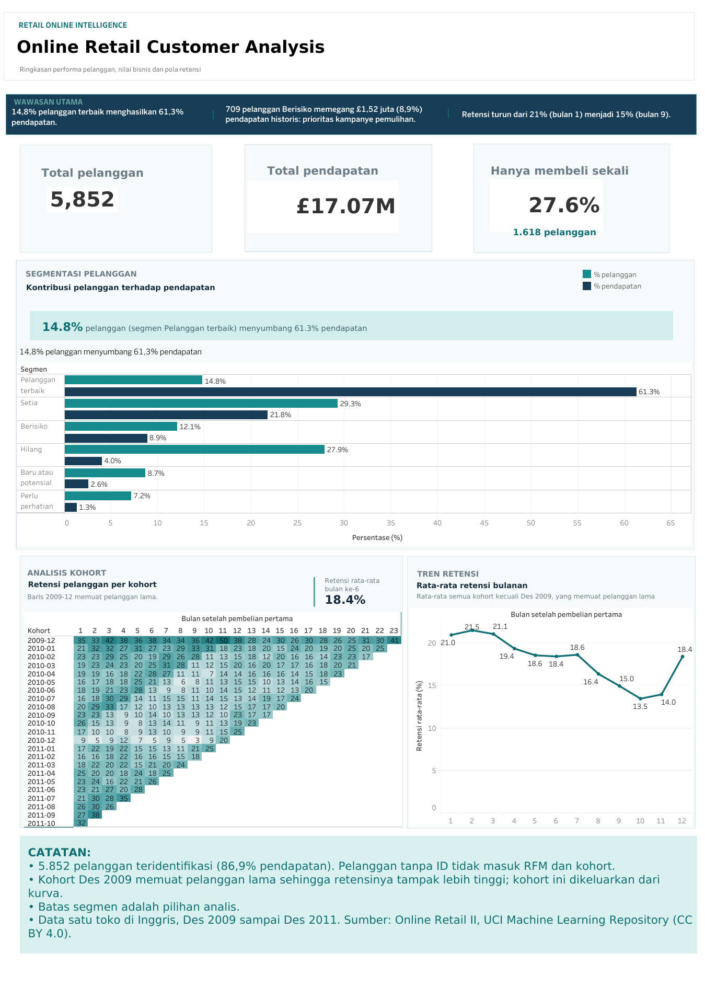

## Segmentasi Pelanggan dan Analisis Retensi: Online Retail II

Proyek ini menganalisis data transaksi sebuah toko online di Inggris. Tujuannya adalah mengetahui pelanggan yang paling bernilai, pelanggan yang berisiko berhenti membeli, dan berapa banyak pelanggan baru yang kembali berbelanja.

Analisis menggunakan segmentasi RFM dan retensi kohort. Proses pembersihan data juga dicatat, termasuk jumlah baris yang dihapus.

**Teknologi:** Python (pandas, NumPy, Matplotlib), Jupyter Notebook, dan Tableau Public.

---

## Daftar Isi

1. [Ringkasan](#ringkasan)
2. [Pertanyaan Bisnis](#pertanyaan-bisnis)
3. [Temuan Utama](#temuan-utama)
4. [Dashboard](#dashboard)
5. [Dataset](#dataset)
6. [Metodologi dan Keputusan Analisis](#metodologi-dan-keputusan-analisis)
7. [Keterbatasan Data](#keterbatasan-data)
8. [Struktur Proyek](#struktur-proyek)
9. [Cara Menjalankan](#cara-menjalankan)
10. [Pengembangan Lanjutan](#pengembangan-lanjutan)
11. [Tentang Pembuat](#tentang-pembuat)
12. [Kredit](#kredit)

---

## Ringkasan

Data transaksi mentah perlu dibersihkan sebelum dianalisis. Data ini terdiri dari dua sheet Excel dengan tanggal yang tumpang tindih, baris duplikat, transaksi pembatalan, kode non-produk, dan banyak baris tanpa ID pelanggan.
Proyek ini terdiri dari empat tahap:

- **Menggabungkan dan membersihkan data.** Setiap aturan pembersihan dicatat bersama jumlah baris dan nilai yang terdampak.
- **Segmentasi RFM.** Pelanggan dikelompokkan berdasarkan *recency* (seberapa baru membeli), *frequency* (seberapa sering), dan *monetary* (seberapa besar nilai belanja) ke dalam enam segmen.
- **Analisis retensi kohort.** Mengukur berapa persen pelanggan baru yang kembali membeli di bulan-bulan berikutnya.
- **Dashboard interaktif** di Tableau Public yang merangkum ketiganya (lihat bagian [Dashboard](#dashboard)).

## Pertanyaan Bisnis

1. Siapa pelanggan paling bernilai, dan seberapa besar kontribusinya terhadap pendapatan?
2. Segmen pelanggan apa yang ada, dan segmen mana yang berisiko hilang?
3. Berapa persen pelanggan yang kembali membeli di bulan-bulan setelah pembelian pertama mereka?

## Temuan Utama

Analisis mencakup 5.852 pelanggan yang memiliki ID, dengan total pendapatan £17,07 juta atau 86,9% dari seluruh pendapatan penjualan. Nilai pendapatan dihitung dengan jumlah barang dikali harga satuan dan tidak memasukkan transaksi pembatalan. Semua nilai uang menggunakan pound sterling (£).

### 1. Pendapatan sangat terkonsentrasi pada sedikit pelanggan

| Kelompok | Jumlah pelanggan | Kontribusi pendapatan |
|---|---:|---:|
| 1% pelanggan teratas | 58 | 31,9% |
| 5% pelanggan teratas | 292 | 51,9% |
| 20% pelanggan teratas | 1.170 | 77,2% |

Sebanyak 27,6% pelanggan hanya berbelanja satu kali. Rata-rata belanja per pelanggan adalah £2.916,7, sedangkan nilai tengahnya hanya £856,0. Pelanggan dengan nilai belanja terbesar mencapai £580.987, sekitar 3,4% dari total pendapatan pelanggan yang memiliki ID.

### 2. Enam segmen pelanggan, dan dua yang paling layak diperhatikan

| Segmen | Pelanggan | % pelanggan | % pendapatan | Median recency (hari) | Median invoice | Median belanja (£) |
|---|---:|---:|---:|---:|---:|---:|
| Pelanggan terbaik | 867 | 14,8 | **61,3** | 12 | 15 | 5.425,6 |
| Setia | 1.713 | 29,3 | 21,8 | 49 | 5 | 1.444,8 |
| Berisiko | 709 | 12,1 | 8,9 | 366 | 4 | 1.153,9 |
| Hilang | 1.630 | 27,9 | 4,0 | 430 | 1 | 292,3 |
| Baru atau potensial | 512 | 8,7 | 2,6 | 25 | 2 | 382,1 |
| Perlu perhatian | 421 | 7,2 | 1,3 | 95 | 1 | 375,1 |

- **Pelanggan terbaik dan Setia** keduanya mencakup 44,1% pelanggan dan menghasilkan 83,1% pendapatan.
- **Berisiko** adalah segmen yang sebaiknya sangat dipertahankan. Sebelumnya mereka cukup sering membeli (median 4 invoice), tetapi sudah sekitar satu tahun tidak kembali. Nilai belanja historis kelompok ini mencapai £1,52 juta atau 8,9% dari pendapatan pelanggan ber-ID.
- **Hilang** adalah segmen terbesar kedua (27,9% pelanggan) tetapi hanya menyumbang 4,0% pendapatan sehingga prioritasnya lebih rendah.

Saran tindakan berikut adalah **hipotesis dari pola data, bukan hasil uji**:

| Segmen | Saran tindakan |
|---|---|
| Pelanggan terbaik | Pertahankan dengan program loyalitas dan pantau ketergantungan pada kelompok ini. |
| Setia | Dorong agar lebih sering berbelanja. |
| Berisiko | Prioritaskan kampanye untuk mengajak mereka kembali. |
| Baru atau potensial | Dorong mereka melakukan pembelian kedua dan ketiga. |
| Perlu perhatian | Kirim pengingat sederhana dengan biaya rendah. |
| Hilang | Gunakan kampanye otomatis berbiaya rendah dan jangan jadikan prioritas utama. |

### 3. Sekitar satu dari lima pelanggan baru membeli lagi di bulan berikutnya

Retensi di sini berarti persentase pelanggan sebuah kohort yang **membeli pada bulan tertentu** setelah pembelian pertama (bukan akumulasi). Angka ini bukan jumlah pelanggan yang terus aktif secara terus menerus. Kohort Desember 2009 tidak disertakan dalam rata-rata utama karena mungkin mencakup pelanggan lama. Alasannya dijelaskan pada bagian [Metodologi](#metodologi-dan-keputusan-analisis).

| Bulan setelah pembelian pertama | Semua kohort | Tanpa kohort Des 2009 |
|---:|---:|---:|
| 1 | 23,3% | **21,0%** |
| 2 | 23,6% | 21,5% |
| 3 | 25,0% | 21,1% |
| 6 | 22,2% | 18,4% |
| 9 | 19,4% | 15,0% |
| 12 | 22,7% | 18,4% |

Tanpa kohort Desember 2009, retensi berada di sekitar 21% sampai bulan ketiga. Angka tersebut turun menjadi sekitar 15–18% pada bulan keenam hingga kedua belas.

### 4. Pembeli di akhir 2010 tampak lebih jarang kembali (dugaan)

Pada kohort Desember 2010 yang terdapatan 76 pelanggan dan hanya 9% kembali membeli pada bulan berikutnya. Angkanya tidak lebih dari 12% sampai bulan kesepuluh. Sebagai perbandingan, kohort Januari–Oktober 2011 memiliki retensi bulan pertama sebesar 16–32%.

Salah satu dugaan adalah pelanggan yang berbelanja untuk musim liburan lebih jarang kembali. Namun, data hanya mencakup satu musim liburan yang bisa dibandingkan, sehingga dugaan ini belum dapat dipastikan.

## Dashboard

Dashboard interaktif dibuat dengan Tableau Public dari tiga file hasil analisis di folder `outputs/`.

**Buka dashboard:** [https://public.tableau.com/app/profile/sarah.tbg/viz/x1_17931249834690/Dashboard2?publish=yes](https://public.tableau.com/app/profile/sarah.tbg/viz/x1_17931249834690/Dashboard2?publish=yes)



## Dataset

Sumber : Dataset Online Retail II berasal dari UCI Machine Learning Repository. Dataset ini memuat transaksi toko online di Inggris yang sebagian besar menjual barang hadiah. Data mencakup 1 Desember 2009 sampai 9 Desember 2011. Banyak pelanggan toko ini adalah pedagang grosir. 
Lisensi dataset: CC BY 4.0.

| Ringkasan | Nilai |
|---|---|
| Format | Satu file Excel dengan dua lembar (2009 sampai 2010 dan 2010 sampai 2011) |
| Jumlah baris | 1.067.371 (525.461 dan 541.910) |
| Kolom | `Invoice`, `StockCode`, `Description`, `Quantity`, `InvoiceDate`, `Price`, `Customer ID`, `Country` |
| Invoice berawalan `C` | Pembatalan |

File Excel tidak disertakan di repository ini (lihat `.gitignore`); unduh dari halaman dataset: https://archive.ics.uci.edu/dataset/502/online+retail+ii

## Metodologi dan Keputusan Analisis

### Menggabungkan dua lembar

Lembar kedua dimulai 1 Desember 2010, sedangkan lembar pertama berlanjut sampai 9 Desember 2010. Periode 1 sampai 9 Desember 2010 ternyata muncul di kedua lembar: **22.523 baris di masing-masing lembar, dan isinya identik** (dibuktikan di notebook 00). Baris tumpang tindih di lembar pertama dibuang berdasarkan tanggal, bukan dengan "drop_duplicates()", supaya baris kembar yang sah di dalam satu lembar tidak ikut terhapus. Hasilnya **1.044.848 baris**.

### Pembersihan data

| # | Aturan | Baris dibuang | Nilai (£) | Alasan |
|---|---|---:|---:|---|
| 1 | Baris kembar persis | 11.812 | 54.228,42 | Sistem seharusnya menggabungkan jumlah, bukan mencatat baris sama dua kali |
| 2 | Pembatalan (invoice berawalan C), **dipisahkan** | 19.104 | -1.462.050,61 | Bukan pembelian; disimpan terpisah untuk analisis pembatalan |
| 3 | Kode non-produk | 4.511 | 671.966,50 | Ongkos kirim, biaya, penyesuaian, dan produk uji coba bukan perilaku pembelian barang |
| 4 | Jumlah atau harga ≤ 0 | 5.987 | 0,00 | Penyesuaian stok dan barang gratis, tanpa nilai uang |

Kode non-produk yang dihapus: POST, DOT, C2 (ongkos kirim), M dan m (input manual), D (diskon), S (sampel), BANK CHARGES, AMAZONFEE, CRUK (biaya dan komisi), ADJUST, ADJUST2, B (penyesuaian dan utang macet), serta TEST001 dan TEST002.

Dari 1.044.848 baris, 41.414 dibuang dan **1.003.434 baris penjualan** tersisa. Dari jumlah itu, 776.596 baris punya Customer ID. Baris tanpa Customer ID **tetap** dihitung sebagai pendapatan di tabel penjualan, tetapi dikeluarkan dari RFM dan kohort karena tidak bisa dilacak per pelanggan.

### RFM

- **Recency:** jumlah hari sejak pembelian terakhir sampai tanggal acuan, yaitu 10 Desember 2011. Tanggal ini dipilih sehari setelah transaksi terakhir. Semakin kecil nilainya, semakin baru pelanggan berbelanja.
- **Frequency:** jumlah invoice unik.
- **Monetary:** total pendapatan pelanggan.
- **Skor 1 sampai 5** pelanggan dibagi menjadi lima kelompok. Pelanggan dengan nilai yang sama selalu mendapat skor yang sama. Karena itu, jumlah pelanggan di setiap kelompok tidak harus sama persis.

### Aturan segmen

Segmen dibentuk dari skor R dan F, dievaluasi berurutan dari atas ke bawah. Nilai belanja menjadi profil, bukan penentu segmen.

| Segmen | Aturan |
|---|---|
| Pelanggan terbaik | R ≥ 4 dan F = 5 |
| Setia | R ≥ 3 dan F ≥ 3 |
| Baru atau potensial | R ≥ 4 dan F ≤ 2 |
| Berisiko | R ≤ 2 dan F ≥ 3 |
| Hilang | R ≤ 2 dan F ≤ 2 |
| Perlu perhatian | Sisanya |

Aturan batas segmen adalah **pilihan analis**, bukan fakta dari data. Untuk "Pelanggan terbaik", lima aturan dibandingkan sebelum dipilih:

| Aturan | Pelanggan | % pelanggan | % pendapatan |
|---|---:|---:|---:|
| R ≥ 4 dan F ≥ 4 | 1.395 | 23,8 | 68,6 |
| R ≥ 4, F ≥ 4, dan M ≥ 4 | 1.258 | 21,5 | 67,9 |
| **R ≥ 4 dan F = 5 (dipilih)** | **867** | **14,8** | **61,3** |
| R = 5 dan F ≥ 4 | 823 | 14,1 | 51,8 |
| R = 5 dan F = 5 | 564 | 9,6 | 48,4 |

Berdasarkan aturan tersebut menghasilkan sekitar 15% pelanggan yang menyumbang sebagian besar pendapatan dan mudah dijelaskan. Menambahkan syarat nilai belanja hanya sedikit mengubah hasil karena pelanggan yang sering berbelanja cenderung juga memiliki nilai belanja tinggi.

### Retensi kohort

- **Kohort** adalah kelompok pelanggan yang pertama kali membeli di bulan yang sama.
- **indeks bulan** adalah jarak bulan dari pembelian pertama.
- **Desember 2011 tidak dihitung** data hanya tersedia sampai 9 Desember. Jika tetap digunakan maka retensi bulan tersebut bisa terlihat rendah karena datanya belum lengkap. Bulan yang belum bisa diamati dibiarkan kosong, bukan dihitung sebagai retensi 0%.
- **Kohort Desember 2009 dipisahkan dari rata-rata**. Data dimulai 1 Desember 2009, sehingga pelanggan lama yang kebetulan membeli di bulan itu ikut tercatat sebagai pelanggan baru. Kohort ini berisi 951 pelanggan (kohort lain 72 sampai 441) dengan retensi 24% sampai 50%, yang kemungkinan membesar karena hal itu.
- Rata-rata dihitung **berbobot ukuran kohort**, dan kurva hanya ditampilkan untuk bulan ke-1 sampai ke-12. Pada bulan yang lebih jauh, hanya segelintir kohort tertua yang bisa diamati sehingga rata-ratanya tidak andal.

## Keterbatasan Data

- **Sebagian data tidak memiliki Customer ID**
    Sekitar 22,5% baris awal tidak punya Customer ID dan setelah pembersihan 13,1% pendapatan tidak bisa dianalisis per pelanggan. RFM dan kohort mencakup 86,9% pendapatan.
-**Data hanya berasal dari satu toko**
    Toko ini menjual barang hadiah dan berlokasi di Inggris. Inggris menyumbang 85,5% pendapatan, diikuti Irlandia 3,2% dan Belanda 2,8%. Temuan ini tidak boleh digeneralisasi ke toko online lain.
- **Terdapat pelanggan dengan nilai belanja sangat besar.**
    Nilai belanja tertinggi adalah £580.987 atau sekitar 3,4% dari pendapatan pelanggan ber-ID. Pelanggan ini mungkin pedagang grosir. Nilai yang sangat besar ini memengaruhi hasil analisis konsentrasi pendapatan.
- **Pendapatan bersifat kotor.** 
    Transaksi pembatalan dipisahkan dan tidak dikurangkan dari pendapatan. Nilai pembatalan sekitar £1,46 juta, atau 7,4% dari pendapatan penjualan £19,65 juta.
- **Batas segmen adalah pilihan analis**, 
    Batas segmen ditentukan sendiri oleh analis. Hasil pengelompokan dapat berbeda jika aturan yang digunakan berubah.
- **Retensi hanya mengukur apakah pelanggan membeli di bulan itu**
    Perhitungan tidak memperhitungkan jumlah atau nilai belanja. Kohort Desember 2009 mungkin mencakup pelanggan lama, dan data hanya mencakup dua tahun sehingga pola musiman belum bisa dipastikan.
- **Analisis bersifat deskriptif.** 
    Data memuat apa yang terjadi, bukan penyebabnya, sehingga penjelasan seperti pengaruh musim liburan hanyalah dugaan dan saran tindakan merupakan hipotesis.

## Struktur Proyek

```
online-retail-customer-analysis/
├── README.md                          (dokumentasi proyek)
├── requirements.txt                   (daftar library Python yang dibutuhkan)
├── .gitignore                         (file dan folder yang tidak diunggah ke Git)
├── notebooks/
│   ├── 00_merge_sheets.ipynb          (menggabungkan dua lembar Excel tanpa tumpang tindih)
│   ├── 01_cleaning.ipynb              (diagnostik dan pembersihan data)
│   ├── 02_rfm_segmentation.ipynb      (perhitungan RFM dan pembentukan segmen)
│   └── 03_cohort_retention.ipynb      (analisis retensi per kohort)
├── outputs/
│   ├── rfm_pelanggan.csv              (RFM, skor, dan segmen per pelanggan)
│   ├── rfm_ringkasan_segmen.csv       (profil tiap segmen)
│   ├── rfm_segmen.png                 (grafik persentase pelanggan dan pendapatan per segmen)
│   ├── kohort_retensi.csv             (retensi tiap kohort dan bulan)
│   ├── kohort_retensi_rata2.csv       (retensi rata-rata)
│   ├── retensi_heatmap.png            (heatmap retensi per kohort)
│   └── retensi_kurva.png              (kurva retensi rata-rata)
├── dashboard/
│   └── dashboard.png                  (screenshot dashboard Tableau Public)
└── data/                              (file Excel dan CSV olahan, tidak di-commit)
```

## Cara Menjalankan

### Prasyarat

- Python 3.10 atau lebih baru
- Jupyter atau VS Code dengan ekstensi Jupyter
- File dataset dari UCI

### Langkah (Windows PowerShell)

**1. Unduh proyek dan siapkan environment Python**

```powershell
git clone https://github.com/srhtbgg13/online-retail-customer-analysis.git
cd online-retail-customer-analysis
python -m venv venv
venv\Scripts\Activate.ps1
pip install -r requirements.txt
```

Jika muncul error *execution policy* saat mengaktifkan venv, jalankan sekali:
`Set-ExecutionPolicy -Scope CurrentUser -ExecutionPolicy RemoteSigned`

**2. Letakkan dataset**

Unduh *Online Retail II* dari halaman UCI (tautan di bagian [Dataset](#dataset)), lalu simpan file Excel-nya di `data/raw/online_retail_II.xlsx` (buat foldernya jika belum ada).

**3. Jalankan notebook secara berurutan**

Buka folder `notebooks/` dan jalankan (**Run All**) satu per satu dari `00` sampai `03`. Notebook `00` membaca file Excel yang besar sehingga memakan waktu sekitar 2 sampai 3 menit; notebook lainnya berjalan dalam hitungan detik.

| Notebook | Hasil yang diharapkan |
|---|---|
| `00_merge_sheets` | `data/raw/online_retail_II_gabungan.csv` berisi 1.044.848 baris |
| `01_cleaning` | `data/processed/penjualan.csv`, `pelanggan.csv`, dan `pembatalan.csv` |
| `02_rfm_segmentation` | `outputs/rfm_pelanggan.csv`, ringkasan segmen, dan grafik |
| `03_cohort_retention` | `outputs/kohort_retensi.csv`, heatmap, dan kurva retensi |

**4. (Opsional) Buat dashboard**

Hubungkan file CSV di folder `outputs/` ke Tableau Public (tipe sumber data: *Text file*), lalu susun dashboard seperti pada bagian [Dashboard](#dashboard).

## Pengembangan Lanjutan

- **Tingkat pembatalan per pelanggan**, memakai tabel pembatalan yang sudah dipisahkan, untuk melihat apakah segmen tertentu lebih sering membatalkan.
- **Memisahkan pelanggan grosir dan ritel** (misalnya berdasarkan ukuran pesanan) karena pola belanjanya kemungkinan berbeda.
- **Analisis keranjang belanja** untuk melihat produk yang sering dibeli bersama.
- **Nilai seumur hidup pelanggan (CLV)** dan prediksi pelanggan yang berisiko hilang.
- **Retensi berbasis nilai**, yaitu membandingkan belanja kohort dari waktu ke waktu, bukan hanya apakah mereka membeli.

## Tentang Pembuat

Dibuat oleh **Sarah** sebagai proyek portofolio di bidang data analytics.

- GitHub: [github.com/srhtbgg13](https://github.com/srhtbgg13)
- Email: [sarahtbg13@gmail.com](mailto:sarahtbg13@gmail.com)

## Kredit

Dataset: Chen, D. (2019). *Online Retail II*. UCI Machine Learning Repository. Lisensi CC BY 4.0. https://archive.ics.uci.edu/dataset/502/online+retail+ii
